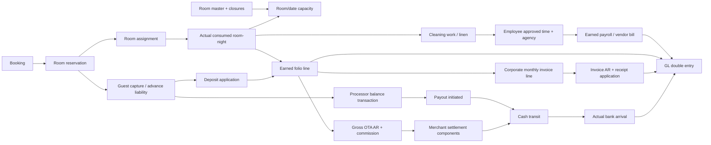

# Карта связей и grains

Машиночитаемая карта — `relationships.csv`, ключи/типы/partitions — `table_schemas.json`. Blank FK разрешён только при неприменимости или ещё не наступившем событии. В metadata condition channel_id=BOOKING/EXPEDIA задаёт разные targets одного settlement_id.

Никогда join двух фактов many-to-many только по reservation_id для sum money: несколько nights × несколько captures × несколько invoice lines умножат строки. Сначала агрегируйте каждый факт по целевому grain, либо соединяйте line-specific payment application/folio_line_id. Аналогично rooms/date ↔ tasks может иметь несколько tasks, нужны count DISTINCT task_id и preaggregation.

Group booking и group allotment различаются: bookings→booking_rooms→reservation; corporate group_blocks→group_pickups→reservation. Occupancy берётся из actual nights, а не количества blocks. Channel reservation export — mapping той же reservation, не дополнительная продажа.

Corporate invoice_line_id→folio_line_id — exact earned service mapping; GL invoices source только перекидывает1130→1100. Merchant settlement_line_id→folio_line_id→commission: folio net+tax−commission−OTA tax=net remittance. Agency commission settlement_id указывает на agency_invoice_id, merchant — на settlement_id.

Bill lines могут ссылаться на operational property/month composite в source_id: это описательная aggregation reference, не универсальный одноколоночный FK. По purchase_order_line_id и bill_line_id есть строгие receipt mappings. General ledger source_id — polymorphic key, source_system/source_table обязательны для join. Для allocation_id source_cost повторяется по recipients и donor; не суммируется.
