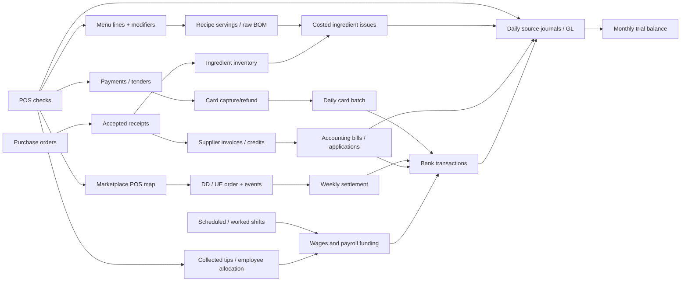

# Связи, cardinality и примеры трассировки

Полный машинный каталог — metadata/relationships.csv / relationships.json. Ниже карта главных потоков. JSON examples содержат копии source records, а не дополнительные операции.

| Связь | Cardinality | Как избежать дублирования |
|---|---|---|
| check → check_lines | 1:N | Header measures не суммировать после line join; считать из lines или distinct header fact |
| line → modifiers | 1:N | Modifier gross уже в parent line; агрегировать add-ons по line до join |
| check → payments → processor events | 1:N; payment → capture 1:1 | Split tenders не означают несколько продаж; refund отдельное событие |
| CLOSED marketplace order ↔ POS check | 1:1 | Считать POS sales; platform event fact добавляет комиссии/settlement |
| check/processor event → daily close/batch | N:1 | Batch/daily close amount — сумма множества чеков, не allocation на каждый чек |
| served menu/add-on → daily recipe usage | N:1 для date/site/recipe/component | В daily usage весь объём дня. Один чек даёт quantity × raw_per_portion, а не всю daily cost |
| daily tip pool → employee allocations | 1:N | Pool за весь день; individual check tip не принадлежит однозначно одному employee |
| PO → lines / shipments / receipts | 1:N; 1:N | Partial shipment и будущий remainder отдельны; credits закрывают short quantity |
| receipt → receipt/invoice lines | 1:N | В stock попадает accepted amount; billed quantity может быть больше |
| supplier invoice ↔ accounting bill | 1:1 | Не суммировать два зеркала начисления |
| bill ↔ vendor payment | N:M через applications | Для cash по bill использовать application amount; один payment может закрывать несколько bills |
| recurring obligation → existing bill | 0:1 | BILLED cycle не добавлять на open AP; будущий NOT_BILLED cycle отдельный |
| cash_commitments → raw source schedule | 1:1 index entry | Выбрать один слой для расчёта; индекс + raw schedule не суммируются |

## Чек CHK-R02-20241101-0128

Смотрите metadata/example_check_trace.json. Original service date 2024-11-01, R02, DINE_IN; net sales USD57.50, tax USD4.30, card tips USD12.65, original due USD74.45. В примере есть add-on и отдельный последующий refund. Пройдите check → lines/modifiers → original tender → capture → daily payout → bank arrival; затем refund → refund processor event → его batch и bank.

GL по sales идёт через общий day_closings.close_id, поэтому приложенные source journals содержат весь день точки. Tip allocations также за весь день; они демонстрируют, куда относится собранный pool, но не уникальное владение tips этого конкретного чека. daily_aggregate_recipe_usage содержит все servings выбранных блюд за день: доля чека количественно вычисляется по его served lines и recipe_components. Не приписывайте ему весь daily issue cost.

## Закупка SINV-000000303 / BILL-SINV-000000303

Смотрите metadata/example_purchase_trace.json. Invoice date 2024-12-13; receipt RCPT-000000303; PO PO-000000290. Billed USD783.45, supplier credit USD25.20, net payable/accepted inventory USD758.25. В этом примере 2 cash applications и отдельный noncash credit.

Порядок: approved PO/pack conversion → planned shipment → фактическая приёмка → accepted inventory movement → supplier invoice mirror → accounting bill gross → shortage/damage credit application → agreed cash installments → vendor payment applications → bank debit. В bank payment может быть несколько bills; сумма bank debit больше доли выбранного bill не является расхождением. Credit уменьшает billed inventory/AP, не банк. Closing AP по bill — gross - credit - applied cash. У PO может быть второй shipment: смотрите весь delivery_schedule/PO lines, не только выбранный invoice.
